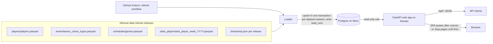
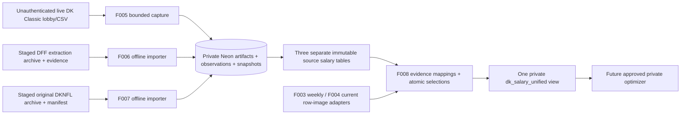

# Architecture: Seam Finder, Part 1 (data prototype)

Status: READY (2026-11-05). Decisions: [ADR 0001](adr/0001-stack-and-hosting.md), [ADR 0002](adr/0002-nflverse-load-and-refresh.md), [ADR 0003](adr/0003-rotoguru-dk-classic-salaries.md) (Accepted), [ADR 0004](adr/0004-dk-current-slate-csv.md) (Accepted), [ADR 0005](adr/0005-private-salary-capture-and-archives.md) (Accepted), [ADR 0006](adr/0006-slate-safe-salary-unification.md) (Accepted), [ADR 0007](adr/0007-authoritative-schedule-completeness.md) (Accepted), [ADR 0008](adr/0008-react-frontend-hosting.md) (Proposed, F009 frontend and asset hosting; not accepted until the F009 docs PR merges).

## Components

| Component | What it is | Where it runs |
|---|---|---|
| Loader | Python CLI. Downloads nflverse-data release files, validates them, upserts into Postgres, writes `load_runs`. | GitHub Actions (scheduled + manual), or locally |
| Database | Postgres. Tables in [data-dictionary.md](data-dictionary.md). | Neon free tier |
| Web app | One FastAPI service. `/api/*` returns JSON. Until Cosmo enables F009 cutover, other paths return Jinja2 HTML from the same query functions. After cutover, the same process serves the built React SPA for those paths. Read-only DB role. | Render free web service |
| Refresh workflow | GitHub Actions workflow that runs the loader. Holds the DB URL as a secret. | GitHub Actions |

One web service and one public origin. After F009, Python remains the API and loader language, and a Vite build in `frontend/` is served by that same FastAPI process, so there is no CORS and no second host. [ADR 0008](adr/0008-react-frontend-hosting.md) is the proposed frontend and hosting decision.

## Data flow

Load order inside one run: teams, players, games, player_week_stats (foreign keys point backwards in that order).

## Deployment

- **Repo**: one repository with `loader/`, `web/`, `frontend/`, `migrations/`, and `tests/`.
- **Database**: Neon project, one database. Two roles: a loader role (DDL + write) used only by GitHub Actions and migrations, and a read-only role used by the web app.
- **Secrets**: `DATABASE_URL` (loader role) as a GitHub Actions secret; `DATABASE_URL` (read-only role) as a Render environment variable. `.env` is git-ignored; `.env.example` holds placeholder values only. The repo is public; see the Secrets rule in the F001 SPEC.
- **Web app**: Render builds from the repo and runs `uvicorn`. Free instances spin down after 15 minutes with no traffic and take about a minute to start again ([Render docs](https://render.com/docs/free)). Today's dashboard build command stays `pip install .` until Cosmo approves F009 cutover. At cutover the build also installs Node 26 and builds `frontend/`, and `SERVE_SPA=true` starts the SPA. No `render.yaml` is committed.
- **Refresh**: `.github/workflows/refresh.yml` with a `schedule` cron and `workflow_dispatch` (input: seasons). Details in [ADR 0002](adr/0002-nflverse-load-and-refresh.md).
- **Migrations**: run by the loader role before loading (see [data-dictionary.md](data-dictionary.md#migration-plan)).

## Cross-cutting rules

- The web app never writes. Its DB role has `SELECT` only.
- Every page shows the attribution footer and the last successful refresh time (from `load_runs`). After F009 cutover the SPA reads those values from `GET /api`.
- Team logos and player headshots are not stored or shown (trademark and image rights are not covered by the nflverse license).

## Future extension points (parts 2-5)

New tables key on the same `gsis_id`, `team_abbr`, `game_id`, and `(season, week)`: e.g. projections per (gsis_id, season, week, model), valuations per (gsis_id, season), DFS salaries per (slate, gsis_id), injuries per (gsis_id, season, week). Cross-site IDs already kept on `players` (`pfr_id`, `espn_id`, `pff_id`, ...) help match outside salary and injury feeds. None of this is built in part 1.

## F003 addition (Accepted)

RotoGuru → loader module for `dk_classic_salaries` → same Neon database. No new host. This pass is data-load only (migration, loader, workflow, tests): no read API endpoints and no browse page. Details in [ADR 0003](adr/0003-rotoguru-dk-classic-salaries.md) and [F003 SPEC](features/F003-dk-classic-salaries/SPEC.md).

## F004 addition (implemented; ADR 0004 Accepted)

Cosmo-supplied DraftKings Classic `DKSalaries.csv` → loader module for `dk_classic_slate` → same Neon database. No draftkings.com fetch. Data-load only until Cosmo says otherwise. Details in [ADR 0004](adr/0004-dk-current-slate-csv.md) and [F004 SPEC](features/F004-dk-current-slate/SPEC.md).

## F005–F008 private salary pipeline (approved; not deployed)

Approved by owner merge of PR #17. [ADR 0005](adr/0005-private-salary-capture-and-archives.md) and [ADR 0006](adr/0006-slate-safe-salary-unification.md) are Accepted. The [constitution](CONSTITUTION.md#data-and-licensing) amendment is operative. F005–F008 specs are READY. ADR 0004 is Accepted on status only; its decision text is unchanged, and ADR 0005 supersedes only its blanket auto-download ban. This status sync does not add a build gate. Build F005 first, then F006 and F007, then F008, each in its own PR. A later feature waits until the PRs it depends on have merged. That order is not permission to skip those merges. Schedule activation and production migration or deploy remain unapproved. The pipeline is not deployed.

- **F005 foundation**: shared `salary_private` artifact, row ledger, observation and snapshot tables; new lobby salary table; bounded unauthenticated HTTP client; separate GHA workflow. F004 CLI and its Tuesday staged-file workflow remain unchanged and never consume live captures automatically.
- **F006/F007**: each adds its own source table and offline re-runnable CLI, no source refresh cron. Input artifacts stay unmodified; exact raw bytes/rows and manifests/evidence are durable in private Neon, not public GitHub or expiring Actions artifacts.
- **F008**: local rebuild CLI + append-only mapping/selection tables + one SQL view, not a materialized refresh service, API or optimizer. A snapshot-coherent anchor defines a pool; alternatives are comparable only after verified entity and exact game/kickoff/rules equivalence. Unknown/legacy/subset/incomplete/disagreement cases remain visible with readiness flags. Successful parsing does not bypass those flags.
- **Isolation**: new private schema is not granted to web or PUBLIC. Replace blanket public SELECT/default grants with explicit public allowlist and revoke web/PUBLIC F004 SELECT so future refreshes cannot undo privacy. Existing public nflverse/RotoGuru reads stay intact. Approved optimizer role has view SELECT only and no web-role membership. No new auth/product account system.
- **Durability**: observation/artifact commit survives parse rejection; parseable raw ledger survives semantic validation failure; a normalized snapshot commits atomically only when that source's promotion rule allows it. F005 keeps the artifact and ledger and does not publish a usable snapshot when any salary is invalid. F006/F007 may keep parsed non-ready snapshots under their own contracts. Advisory locks enforce dedupe and byte budgets. Source repeats dedupe content/parsed rows but every capture attempt has its own timestamp, wall-clock start/finish, and private monotonic duration. Crash recovery uses recorded commit evidence, not assumptions, and does not invent a missing duration.
- **Free-tier bounds**: bytea exact artifacts in Neon; no new account/storage service. Proposed 5 MiB/object, 64 MiB/invocation, 128 MiB cumulative raw artifacts, 512 MiB DB guards and verified free-allowance headroom checks halt writes without purging prior history. These are application guard proposals, not a current pricing statement.
- **Scheduling**: Cosmo approved Wednesday 10:00 America/New_York during REG season on 2026-11-06 16:59 EST, and the Sunday-afternoon 1:00–4:30 PM America/New_York exact game-set rule, including holiday weeks, on 17:00 EST. Current GitHub Actions supports `timezone: America/New_York` alongside cron (`0 10 * * 3`); UTC is the default only if timezone is omitted. 10:00 is outside the DST spring-forward gap. Jobs can still delay or drop, and public-repo idle schedules disable after 60 days. This docs package does not add or activate the workflow. No Sunday refresh and no Grok Bot routine. See F005 for the documentation links and fail-closed selection.

Build order after the PR #17 docs approval: F005 shared persistence/privacy and capture, then F006 and F007 importers, then F008 view/adapters/selections. Each is a separate PR and includes its acceptance tests and a Mutator report. F006 and F007 start after the F005 foundation PR merges. F008 starts after those source PRs merge. Do not skip a dependency merge. This sequence is not a new docs gate. Docs approval and CI do not run a production load, migration, or schedule. Production migration and deploy remain unapproved. ADR 0007 acceptance is the contract only. PR #19 stays open, and its implementation merge stays held pending the independent gate.

## F005 schedule completeness (ADR 0007 Accepted)

[ADR 0007](adr/0007-authoritative-schedule-completeness.md) is the completeness contract Cosmo approved on 2026-11-06 19:14 EST and that PR #20 merged. No product question remains, and no season inventory is certified. The chain is an operator-reviewed league reference, a pinned private authority root, exact nflverse raw bytes, an automatic source-to-PG receipt, then a whole-season Postgres comparison and finite timing or gap proof before any DK call. A fresh games load, surviving rows, endpoint dates, a row count, or a self-hash is not that proof. Reference authenticity is the operator review. Completeness is equality with that reviewed inventory. There is no new automatic league-schedule scraper. Positive paths remain a verified in-season capture and a finite supported off-season gap. Incomplete prior-year evidence and an unsupported calendar gap fail closed. Contract acceptance is not implementation acceptance. PR #19 remains open, and its implementation merge stays held.

## F009 React frontend (Proposed)

Drafted 2026-11-10 against main `36636c2`. Docs only. [F009 SPEC](features/F009-react-frontend/SPEC.md) and [ADR 0008](adr/0008-react-frontend-hosting.md) are Proposed. A [pending constitution amendment](features/F009-react-frontend/CONSTITUTION-AMENDMENT.md) is required because the accepted constitution still names Jinja2 pages and a blanket bundler ban. Nothing here hands the feature to forge or changes the live site.

Phase 1 replaces the Jinja pages at `/`, `/teams`, `/players`, `/games`, `/stats`, and `/load-runs` with a React, TypeScript, and Vite app in `frontend/`. Tables use TanStack Table and TanStack Virtual. Fetching uses TanStack Query. Routing uses TanStack Router because those pages already persist filter, sort, and paging in the URL. There is no TanStack Start and no SSR. FastAPI keeps serving the existing JSON API, plus additive footer fields on `GET /api`. The same Render web service serves the built assets after cutover. The default `SERVE_SPA` switch is off, so Jinja remains until Cosmo enables it. The frontend and the public API never expose `salary_private` or other private salary data. The public web role grants are unchanged.
