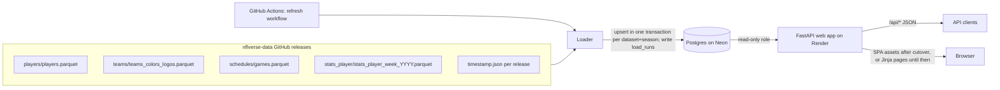
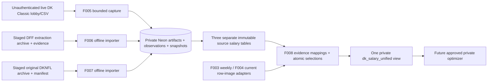

# Architecture: Seam Finder, Part 1 (data prototype)

Status: READY (2026-11-05). Decisions: [ADR 0001](adr/0001-stack-and-hosting.md), [ADR 0002](adr/0002-nflverse-load-and-refresh.md), [ADR 0003](adr/0003-rotoguru-dk-classic-salaries.md) (Accepted), [ADR 0004](adr/0004-dk-current-slate-csv.md) (Accepted), [ADR 0005](adr/0005-private-salary-capture-and-archives.md) (Accepted), [ADR 0006](adr/0006-slate-safe-salary-unification.md) (Accepted), [ADR 0007](adr/0007-authoritative-schedule-completeness.md) (Accepted), [ADR 0008](adr/0008-react-frontend-hosting.md) (Accepted 2026-11-10 20:05 America/New_York by PR #26 merge `2a72ed0`, contract only; no implementation built), [ADR 0009](adr/0009-dknfl-kickoff-tolerance-and-free-agent-rows.md) (Accepted 2026-11-10 20:32 America/New_York, effective when PR #30 merges; F007 kickoff tolerance and free-agent row skips), [ADR 0010](adr/0010-frontend-design-system-and-visual-checks.md) (Accepted, PR #33 `3b61fcd`), [ADR 0011](adr/0011-public-dataset-query-grammar.md) (Proposed 2026-11-11), [ADR 0012](adr/0012-bounded-dk-discovery-projection.md) (Proposed 2026-11-11, pending Cosmo's approval; getcontests discovery read and DraftGroups projection only).

## Components

| Component | What it is | Where it runs |
|---|---|---|
| Loader | Python CLI. Downloads nflverse-data release files, validates them, upserts into Postgres, writes `load_runs`. | GitHub Actions (scheduled + manual), or locally |
| Database | Postgres. Tables in [data-dictionary.md](data-dictionary.md). | Neon free tier |
| Web app | One FastAPI service. `/api/*` returns JSON. Until Cosmo enables F009 cutover, other paths return Jinja2 HTML from the same query functions. After cutover, the same process serves the built React SPA for those paths. Read-only DB role. | Render free web service |
| Refresh workflow | GitHub Actions workflow that runs the loader. Holds the DB URL as a secret. | GitHub Actions |

One web service and one public origin. After F009, Python remains the API and loader language, and a Vite build in `frontend/` is served by that same FastAPI process, so there is no CORS and no second host. [ADR 0008](adr/0008-react-frontend-hosting.md) is the proposed frontend and hosting decision.

## Data flow

Load order inside one run: teams, players, games, player_week_stats (foreign keys point backwards in that order).

## Deployment

- **Repo**: one repository with `loader/`, `web/`, `frontend/`, `migrations/`, and `tests/`.
- **Database**: Neon project, one database. Two roles: a loader role (DDL + write) used only by GitHub Actions and migrations, and a read-only role used by the web app.
- **Secrets**: `DATABASE_URL` (loader role) as a GitHub Actions secret; `DATABASE_URL` (read-only role) as a Render environment variable. `.env` is git-ignored; `.env.example` holds placeholder values only. The repo is public; see the Secrets rule in the F001 SPEC.
- **Web app**: Render builds from the repo and runs `uvicorn`. Free instances spin down after 15 minutes with no traffic and take about a minute to start again ([Render docs](https://render.com/docs/free)). Today's dashboard build command stays `pip install .` until Cosmo approves F009 cutover. At cutover the build also installs Node 26 and builds `frontend/`, and `SERVE_SPA=true` starts the SPA. No `render.yaml` is committed.
- **Refresh**: `.github/workflows/refresh.yml` with a `schedule` cron and `workflow_dispatch` (input: seasons). Details in [ADR 0002](adr/0002-nflverse-load-and-refresh.md).
- **Migrations**: run by the loader role before loading (see [data-dictionary.md](data-dictionary.md#migration-plan)).

## Cross-cutting rules

- The web app never writes. Its DB role has `SELECT` only.
- Every page shows the attribution footer and the last successful refresh time (from `load_runs`). After F009 cutover the SPA footer attribution is the static attribution fallback in the bundle, checked against `web/attribution.py`. The SPA reads `last_refresh_et` and `datasets` from `GET /api`, and shows `Last refresh: none` when those fields are missing or the request fails.
- Team logos and player headshots are not stored or shown (trademark and image rights are not covered by the nflverse license).

## Future extension points (parts 2-5)

New tables key on the same `gsis_id`, `team_abbr`, `game_id`, and `(season, week)`: e.g. projections per (gsis_id, season, week, model), valuations per (gsis_id, season), DFS salaries per (slate, gsis_id), injuries per (gsis_id, season, week). Cross-site IDs already kept on `players` (`pfr_id`, `espn_id`, `pff_id`, ...) help match outside salary and injury feeds. None of this is built in part 1.

## F003 addition (Accepted)

RotoGuru → loader module for `dk_classic_salaries` → same Neon database. No new host. This pass is data-load only (migration, loader, workflow, tests): no read API endpoints and no browse page. Details in [ADR 0003](adr/0003-rotoguru-dk-classic-salaries.md) and [F003 SPEC](features/F003-dk-classic-salaries/SPEC.md).

## F004 addition (implemented; ADR 0004 Accepted)

Cosmo-supplied DraftKings Classic `DKSalaries.csv` → loader module for `dk_classic_slate` → same Neon database. No draftkings.com fetch. Data-load only until Cosmo says otherwise. Details in [ADR 0004](adr/0004-dk-current-slate-csv.md) and [F004 SPEC](features/F004-dk-current-slate/SPEC.md).

## F005–F008 private salary pipeline (approved; not deployed)

Approved by owner merge of PR #17. [ADR 0005](adr/0005-private-salary-capture-and-archives.md) and [ADR 0006](adr/0006-slate-safe-salary-unification.md) are Accepted. The [constitution](CONSTITUTION.md#data-and-licensing) amendment is operative. F005–F008 specs are READY. ADR 0004 is Accepted on status only; its decision text is unchanged, and ADR 0005 supersedes only its blanket auto-download ban. This status sync does not add a build gate. Build F005 first, then F006 and F007, then F008, each in its own PR. A later feature waits until the PRs it depends on have merged. That order is not permission to skip those merges. Schedule activation and production migration or deploy remain unapproved. The pipeline is not deployed.

- **F005 foundation**: shared `salary_private` artifact, row ledger, observation and snapshot tables; new lobby salary table; bounded unauthenticated HTTP client; separate GHA workflow. F004 CLI and its Tuesday staged-file workflow remain unchanged and never consume live captures automatically.
- **F006/F007**: each adds its own source table and offline re-runnable CLI, no source refresh cron. Input artifacts stay unmodified; exact raw bytes/rows and manifests/evidence are durable in private Neon, not public GitHub or expiring Actions artifacts. Accepted [ADR 0009](adr/0009-dknfl-kickoff-tolerance-and-free-agent-rows.md) (effective when PR #30 merges) lets F007 tolerate a unique same-date kickoff within 30 minutes (canonical `kickoff_at` is the schedule instant; the file clock is audited) and skip an exact `TeamAbbrev=FA` / `Game Info=-` row with an audit and a 2% file bound. Wider mismatches and other unparsed Game Info still fail closed. This is not a forge handoff until Cosmo merges PR #30.
- **F008**: local rebuild CLI + append-only mapping/selection tables + one SQL view, not a materialized refresh service, API or optimizer. A snapshot-coherent anchor defines a pool; alternatives are comparable only after verified entity and exact game/kickoff/rules equivalence. Unknown/legacy/subset/incomplete/disagreement cases remain visible with readiness flags. Successful parsing does not bypass those flags.
- **Isolation**: new private schema is not granted to web or PUBLIC. Replace blanket public SELECT/default grants with explicit public allowlist and revoke web/PUBLIC F004 SELECT so future refreshes cannot undo privacy. Existing public nflverse/RotoGuru reads stay intact. Approved optimizer role has view SELECT only and no web-role membership. No new auth/product account system.
- **Durability**: observation/artifact commit survives parse rejection; parseable raw ledger survives semantic validation failure; a normalized snapshot commits atomically only when that source's promotion rule allows it. F005 keeps the artifact and ledger and does not publish a usable snapshot when any salary is invalid. F006/F007 may keep parsed non-ready snapshots under their own contracts. Advisory locks enforce dedupe and byte budgets. Source repeats dedupe content/parsed rows but every capture attempt has its own timestamp, wall-clock start/finish, and private monotonic duration. Crash recovery uses recorded commit evidence, not assumptions, and does not invent a missing duration.
- **Free-tier bounds**: bytea exact artifacts in Neon; no new account/storage service. Proposed 5 MiB/object, 64 MiB/invocation, 128 MiB cumulative raw artifacts, 512 MiB DB guards and verified free-allowance headroom checks halt writes without purging prior history. These are application guard proposals, not a current pricing statement.
- **Discovery read (ADR 0012 Proposed, 2026-11-11):** the getcontests discovery URL may be read to 32 MiB. A body above 5 MiB and within that read limit is held in memory and stored only as its `DraftGroups` projection, which itself must fit the 5 MiB object cap. The salary CSV, rules, and `draftgroups/v1` fetches stay on the 5 MiB full-retention rule. Pending Cosmo's approval. A new `artifact_kind` needs a check-constraint migration; production migration is separately unapproved.
- **Scheduling**: Cosmo approved Wednesday 10:00 America/New_York during REG season on 2026-11-06 16:59 EST, and the Sunday-afternoon 1:00–4:30 PM America/New_York exact game-set rule, including holiday weeks, on 17:00 EST. Current GitHub Actions supports `timezone: America/New_York` alongside cron (`0 10 * * 3`); UTC is the default only if timezone is omitted. 10:00 is outside the DST spring-forward gap. Jobs can still delay or drop, and public-repo idle schedules disable after 60 days. This docs package does not add or activate the workflow. No Sunday refresh and no Grok Bot routine. See F005 for the documentation links and fail-closed selection.

Build order after the PR #17 docs approval: F005 shared persistence/privacy and capture, then F006 and F007 importers, then F008 view/adapters/selections. Each is a separate PR and includes its acceptance tests and a Mutator report. F006 and F007 start after the F005 foundation PR merges. F008 starts after those source PRs merge. Do not skip a dependency merge. This sequence is not a new docs gate. Docs approval and CI do not run a production load, migration, or schedule. Production migration and deploy remain unapproved. ADR 0007 acceptance is the contract only. PR #19 stays open, and its implementation merge stays held pending the independent gate.

## F005 schedule completeness (ADR 0007 Accepted)

[ADR 0007](adr/0007-authoritative-schedule-completeness.md) is the completeness contract Cosmo approved on 2026-11-06 19:14 EST and that PR #20 merged. No product question remains, and no season inventory is certified. The chain is an operator-reviewed league reference, a pinned private authority root, exact nflverse raw bytes, an automatic source-to-PG receipt, then a whole-season Postgres comparison and finite timing or gap proof before any DK call. A fresh games load, surviving rows, endpoint dates, a row count, or a self-hash is not that proof. Reference authenticity is the operator review. Completeness is equality with that reviewed inventory. There is no new automatic league-schedule scraper. Positive paths remain a verified in-season capture and a finite supported off-season gap. Incomplete prior-year evidence and an unsupported calendar gap fail closed. Contract acceptance is not implementation acceptance. PR #19 remains open, and its implementation merge stays held.

## F005 discovery projection (ADR 0012 Proposed)

[ADR 0012](adr/0012-bounded-dk-discovery-projection.md) is Proposed, pending Cosmo's approval. It supersedes ADR 0005 only for the oversize-body rule on `https://www.draftkings.com/lobby/getcontests?sport=NFL`. Capture run 43049995926 failed closed with `storage_guard_object` and no salary rows. The live body was not read. The proposal reads that discovery URL to 33,554,432 decoded bytes, stores a canonical `DraftGroups` projection when the body is over 5 MiB and within the read limit, and leaves the CSV, rules, and `draftgroups/v1` documents on the 5 MiB full-retention rule. `Contests` is not stored. F005 R10 and AT17–AT23 are the spec contract. Forge waits for ADR approval. The new artifact kind needs a migration; this package does not add one, and production migration stays unapproved. No week-10 snapshot is created here.

## F009 React frontend (DRAFT)

Drafted 2026-11-10 against main `36636c2`. Docs only. [F009 SPEC](features/F009-react-frontend/SPEC.md) is DRAFT rev 2. [ADR 0008](adr/0008-react-frontend-hosting.md) is Accepted as a contract by the PR #26 merge `2a72ed0`. No implementation is built. Cosmo approved the [constitution amendment](features/F009-react-frontend/CONSTITUTION-AMENDMENT.md) on 2026-11-10 20:03 America/New_York. The `docs/CONSTITUTION.md` edit takes effect when this follow-up PR merges. Nothing here hands the feature to forge or changes the live site.

Phase 1 replaces the Jinja pages at `/`, `/teams`, `/players`, `/games`, `/stats`, and `/load-runs` with a React, TypeScript, and Vite app in `frontend/`. Tables use TanStack Table and TanStack Virtual. Fetching uses TanStack Query. Routing uses TanStack Router because those pages already persist filter, sort, and paging in the URL. There is no TanStack Start and no SSR. FastAPI keeps serving the existing JSON API, plus additive footer fields on `GET /api`. The same Render web service serves the built assets after cutover. The default `SERVE_SPA` switch is off, so Jinja remains until Cosmo enables it. The frontend and the public API never expose `salary_private` or other private salary data. The public web role grants are unchanged.

## F010–F011 frontend styling and interaction plan

Planning reference: main `0ab6132` includes the F009 implementation (PR #31). The F009 DRAFT/no-implementation paragraphs above record the earlier planning state, not the present code inventory. Live `SERVE_SPA=true` and the updated Render build are coordinator-relayed context, not independently verified here; this package changes neither setting.

Accepted [ADR 0010](adr/0010-frontend-design-system-and-visual-checks.md) (PR #33, `3b61fcd`; status-only sync): the existing `frontend/` React/TypeScript/Vite SPA uses global semantic CSS custom properties, component CSS Modules, native controls, a fixed dark theme and small bundled Inter assets. No UI framework, second host, SSR or new bundler. [F010](features/F010-visual-redesign/SPEC.md) supplies tokens/shell/states/responsiveness/a11y and a deterministic screenshot/axe CI gate. Synthetic route-mocked visual fixtures supplement the existing real-FastAPI/Postgres E2E tests, API on/off tests and backend checks, not replace them.

[F011](features/F011-premium-tables/SPEC.md) starts after F010's build PR merges. Existing dataset filter/single-sort/paging calls stay unchanged. TanStack Table/Virtual handles labeled current-page multi-sort/search/filter/column layout/density and local CSV download. New `ui_*` Router search state is frontend-only and excluded from API query serialization; unknown/invalid UI state falls back safely. A <=80-row DOM bound on a 5,000-row synthetic fixture verifies virtualization, not a claim of dataset-wide loading or measured frame rate.

There is no public salary page/endpoint today; current points columns are nflverse stats, not RotoGuru DK points. No salary filter or historical disclaimer is rendered without a separately approved public salary display. Exact static nflverse attribution remains on every route/state; any future historical DK display must use `ROTOGURU_DK_CLASSIC_ATTRIBUTION` exactly. No API/schema/data-dictionary/grants/private-access changes or production actions. ADR 0008 hosting and rollback stay intact.

## F012–F013 dataset-wide public query plan (READY; not built)

Planning read: main `f5324a4`. F010 is merged via PR #34; F011 remains the dependency for the next build. [F012](features/F012-dataset-query/SPEC.md) adds opt-in `sorts`, `filters`, `search` on the five existing public lists, with exhaustive typed public-column registries, max-three priorities/null-last/unique ties, AND-combined filters and fixed literal text search. Legacy-only queries retain exact behavior and unknown params still 400. Proposed [ADR 0011](adr/0011-public-dataset-query-grammar.md) records this significant query/count/index strategy; no architecture acceptance is inferred from the relayed product approval.

Count/page use one short read-only repeatable-read snapshot; exact total survives empty offset pages. SQLAlchemy Core binds values, with no raw SQL/column discovery or private joins. Advanced SQL execution budget 3000ms and two admitted transactions per process bound individual work, not aggregate abuse. No-store timeout/busy 503s are an explicit narrow new cache-header exception; all old API contracts remain. No pg_trgm or new service.

Forge writes two specified public stats order/cohort B-tree indexes (definitions/evidence in F012 and data dictionary); no web-role grants or data columns change. Indexes support reads but their creation is DDL. **Production application needs separate Cosmo approval**, lock/headroom review and attention to existing automatic `alembic upgrade head` refresh paths. No production workflow is triggered by planning/CI. Synthetic local/CI plans must record count and page cost, index bytes and cold/warm conditions; contains scans and exact counts can still timeout on free-tier compute. No paid upgrade is authorized.

[F013](features/F013-dataset-table-controls/SPEC.md), built separately after F012/F011 merge, adds explicit This page/All matching rows scope. Old URLs stay page-scoped; new navigation links opt into dataset mode. F011 `ui_*` state is mapped to F012 params at one serializer boundary and never sent verbatim. Dataset mode bypasses local sort/filter row models, retaining virtual/layout controls, server pager/total, and explicitly current-page-only guarded CSV. Fixed-text search differences are disclosed; no silent conversion of old all-scalar search. Dataset-wide CSV/facets deferred, no API crawling or public salary exposure. Exact attribution and conditional RotoGuru rule remain unchanged. Sequence: F011 merge -> F012 build/merge -> F013 build/merge; owner-only production rollout separately.
