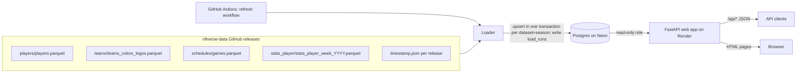

# Architecture: Seam Finder, Part 1 (data prototype)

Status: READY (2026-11-05). Decisions: [ADR 0001](adr/0001-stack-and-hosting.md), [ADR 0002](adr/0002-nflverse-load-and-refresh.md), [ADR 0003](adr/0003-rotoguru-dk-classic-salaries.md) (Proposed).

## Components

| Component | What it is | Where it runs |
|---|---|---|
| Loader | Python CLI. Downloads nflverse-data release files, validates them, upserts into Postgres, writes `load_runs`. | GitHub Actions (scheduled + manual), or locally |
| Database | Postgres. Tables in [data-dictionary.md](data-dictionary.md). | Neon free tier |
| Web app | One FastAPI service. `/api/*` returns JSON; other paths return server-rendered HTML (Jinja2) built from the same query functions. Read-only DB role. | Render free web service |
| Refresh workflow | GitHub Actions workflow that runs the loader. Holds the DB URL as a secret. | GitHub Actions |

One language (Python) and one web service. No separate frontend build, no CORS, no second host.

## Data flow

Load order inside one run: teams, players, games, player_week_stats (foreign keys point backwards in that order).

## Deployment

- **Repo**: one Python package with `loader/`, `app/`, `migrations/`, `tests/`.
- **Database**: Neon project, one database. Two roles: a loader role (DDL + write) used only by GitHub Actions and migrations, and a read-only role used by the web app.
- **Secrets**: `DATABASE_URL` (loader role) as a GitHub Actions secret; `DATABASE_URL` (read-only role) as a Render environment variable. `.env` is git-ignored; `.env.example` holds placeholder values only. The repo is public; see the Secrets rule in the F001 SPEC.
- **Web app**: Render builds from the repo and runs `uvicorn`. Free instances spin down after 15 minutes with no traffic and take about a minute to start again ([Render docs](https://render.com/docs/free)).
- **Refresh**: `.github/workflows/refresh.yml` with a `schedule` cron and `workflow_dispatch` (input: seasons). Details in [ADR 0002](adr/0002-nflverse-load-and-refresh.md).
- **Migrations**: run by the loader role before loading (see [data-dictionary.md](data-dictionary.md#migration-plan)).

## Cross-cutting rules

- The web app never writes. Its DB role has `SELECT` only.
- Every HTML page shows the attribution footer and the last successful refresh time (from `load_runs`).
- Team logos and player headshots are not stored or shown (trademark and image rights are not covered by the nflverse license).

## Future extension points (parts 2-5)

New tables key on the same `gsis_id`, `team_abbr`, `game_id`, and `(season, week)`: e.g. projections per (gsis_id, season, week, model), valuations per (gsis_id, season), DFS salaries per (slate, gsis_id), injuries per (gsis_id, season, week). Cross-site IDs already kept on `players` (`pfr_id`, `espn_id`, `pff_id`, ...) help match outside salary and injury feeds. None of this is built in part 1.

## F003 addition (Proposed)

RotoGuru → loader module for `dk_classic_salaries` → same Neon database. No new host. This pass is data-load only (migration, loader, workflow, tests): no read API endpoints and no browse page. Details in [ADR 0003](adr/0003-rotoguru-dk-classic-salaries.md) and [F003 SPEC](features/F003-dk-classic-salaries/SPEC.md).

